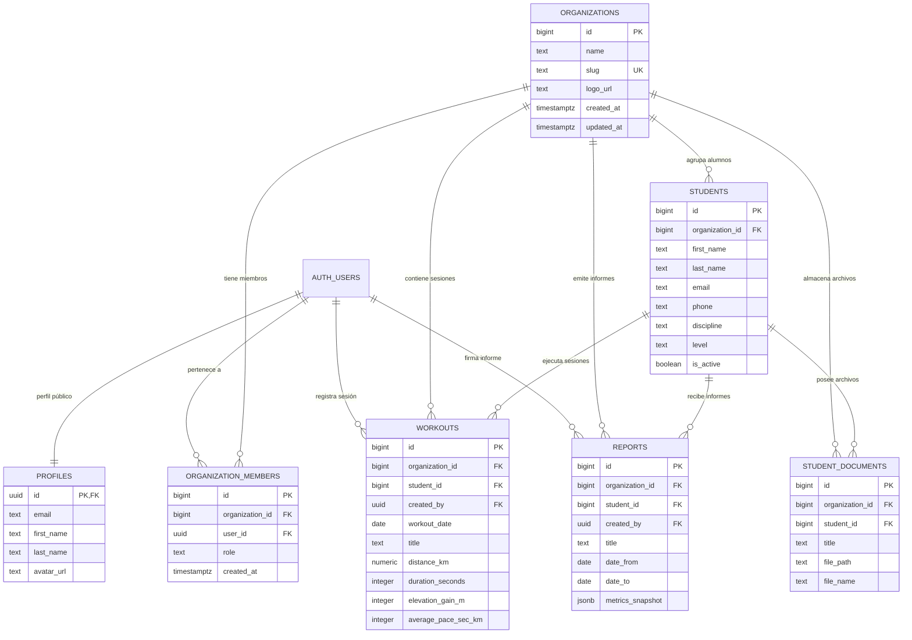

# BARDIA — Relaciones de Base de Datos y Mapeo de Consultas

## 1. Diagrama de Relaciones de Entidades (ER)

---

## 2. Cardinalidades y Comportamiento ante Eliminación (Cascade vs Set Null)

| Relación (Origen -> Destino) | Tipo | Clave Foránea | Regla ON DELETE | Justificación Arquitectónica |
|---|---|---|---|---|
| `auth.users -> profiles` | 1 a 1 | `profiles.id -> auth.users.id` | `CASCADE` | Si la cuenta de autenticación se elimina, su perfil debe destruirse inmediatamente. |
| `organizations -> organization_members` | 1 a N | `organization_members.organization_id -> organizations.id` | `CASCADE` | Si un tenant se destruye, todas sus membresías quedan anuladas. |
| `auth.users -> organization_members` | 1 a N | `organization_members.user_id -> auth.users.id` | `CASCADE` | Si el usuario es dado de baja, se revocan todas sus vinculaciones. |
| `organizations -> students` | 1 a N | `students.organization_id -> organizations.id` | `CASCADE` | Los alumnos pertenecen ontológicamente a la organización. |
| `students -> workouts` | 1 a N | `workouts.student_id -> students.id` | `CASCADE` | Las sesiones de entrenamiento pertenecen al historial del alumno. |
| `organizations -> workouts` | 1 a N | `workouts.organization_id -> organizations.id` | `CASCADE` | Consistencia multi-tenant directa para consultas particionadas. |
| `auth.users -> workouts` | 1 a N | `workouts.created_by -> auth.users.id` | `SET NULL` | Si el entrenador que cargó la sesión deja el club, la sesión histórica debe conservarse sin huérfanos. |
| `students -> student_documents` | 1 a N | `student_documents.student_id -> students.id` | `CASCADE` | Los certificados médicos y aptos físicos corresponden al alumno. |
| `organizations -> student_documents` | 1 a N | `student_documents.organization_id -> organizations.id` | `CASCADE` | Aislamiento de storage en tenant. |
| `students -> reports` | 1 a N | `reports.student_id -> students.id` | `CASCADE` | Los informes evaluativos corresponden al alumno. |
| `organizations -> reports` | 1 a N | `reports.organization_id -> organizations.id` | `CASCADE` | Los informes pertenecen al registro institucional del club. |
| `auth.users -> reports` | 1 a N | `reports.created_by -> auth.users.id` | `SET NULL` | El informe A4 emitido preserva su validez histórica aún si el entrenador se desvincula. |

---

## 3. Mapeo de Consultas del Código Fuente por Entidad

### 3.1. `organizations` y `organization_members`
- **Lectura en Server Components:**
  - `src/app/(dashboard)/layout.tsx`: Consulta `organization_members` uniendo `organizations` para resolver el nombre del equipo en el Navbar.
  - `src/app/(dashboard)/settings/organization/page.tsx`: Consulta membresía activa y lista miembros con sus `profiles`.
  - `src/lib/supabase/get-org.ts`: Función de resolución segura `getOrInitUserOrganization` que retorna `organizationId` y `role`.
- **Modificación:**
  - `src/app/(auth)/login/page.tsx`: Llama a RPC `create_organization_and_owner` tras el signup.
  - `src/app/(dashboard)/settings/organization/OrganizationSettingsClient.tsx`: Actualiza el nombre de la organización (`UPDATE organizations SET name = ... WHERE id = ...`).
  - `src/app/(dashboard)/layout.tsx` y `settings/organization/page.tsx`: Auto-inicialización de organización de rescate vía RPC.

### 3.2. `students`
- **Lectura en Server Components:**
  - `src/app/(dashboard)/dashboard/page.tsx`: Obtiene lista de alumnos para contar el KPI de deportistas activos y listar los 5 más recientes.
  - `src/app/(dashboard)/students/page.tsx`: Lista general ordenada por apellido.
  - `src/app/(dashboard)/students/[id]/page.tsx`: Detalle de alumno por ID (`.eq('id', studentId).single()`).
  - `src/app/(dashboard)/workouts/new/page.tsx`: Carga combo de selección de alumno.
  - `src/app/(dashboard)/reports/new/page.tsx`: Carga combo de selección de alumno.
- **Modificación:**
  - `src/app/(dashboard)/students/new/page.tsx`: Inserta nuevo deportista vinculándolo obligatoriamente a la organización del usuario autenticado.

### 3.3. `workouts`
- **Lectura en Server Components:**
  - `src/app/(dashboard)/dashboard/page.tsx`: Últimos 8 entrenamientos con datos del alumno para calcular km y desnivel acumulado.
  - `src/app/(dashboard)/workouts/page.tsx`: Tabla global de sesiones.
  - `src/app/(dashboard)/students/[id]/page.tsx`: Historial de entrenamientos del alumno (`.eq('student_id', studentId)`).
  - `src/app/(dashboard)/reports/new/page.tsx`: Consulta de sesiones en el rango `[date_from, date_to]` para calcular el snapshot métrico.
- **Modificación:**
  - `src/app/(dashboard)/workouts/new/page.tsx`: Inserta entrenamiento asociando `organization_id` y `student_id`.

### 3.4. `student_documents`
- **Lectura:**
  - `src/app/(dashboard)/students/[id]/page.tsx`: Lista de documentos del deportista.
- **Modificación:**
  - `src/app/(dashboard)/students/[id]/StudentProfileView.tsx`: Inserta metadatos tras subir el archivo físico al bucket privado de Storage.
  - `src/app/(dashboard)/students/[id]/StudentProfileView.tsx`: Elimina el registro de base de datos y el objeto en Storage.

### 3.5. `reports`
- **Lectura:**
  - `src/app/(dashboard)/reports/page.tsx`: Lista general de reportes emitidos.
  - `src/app/(dashboard)/reports/[id]/page.tsx`: Reporte individual con join a `students` y `organizations(name)`.
- **Modificación:**
  - `src/app/(dashboard)/reports/new/page.tsx`: Genera e inserta el reporte junto con el snapshot congelado de métricas.

---

## 4. Discrepancias Detectadas y Acciones de Mitigación

1. **Falta de filtrado explícito por `organization_id` en Server Components (Defensa en Profundidad):**  
   - *Hallazgo:* En `dashboard/page.tsx`, `students/page.tsx`, `workouts/page.tsx` y `reports/page.tsx`, las consultas hacen `.from('students').select('*')` sin filtrar `.eq('organization_id', orgId)`.
   - *Impacto:* Si bien Supabase RLS restringe filas a nivel de PostgreSQL, la arquitectura multi-tenant robusta requiere defensa en profundidad en la capa de aplicación para evitar fugas si una política RLS sufre regresiones o si el usuario pertenece a más de una organización.
   - *Acción:* Implementar resolución de `orgId` activo e inyectar el filtro explícito en todas las consultas de lectura y mutación.

2. **Inexistencia de registro del autor (`created_by`) en `workouts` y `reports`:**  
   - *Hallazgo:* La tabla posee la columna `created_by uuid`, pero los formularios de alta en `workouts/new` y `reports/new` la omitían.
   - *Acción:* Obtener `user.id` e incluir `created_by: user.id` en el payload de inserción.

3. **Inexistencia de flujo de baja lógica (`is_active`):**  
   - *Hallazgo:* La columna `is_active` está tipada en `Student`, pero no existía control en la UI para archivar o restaurar un alumno.
   - *Acción:* Implementar acción de alternancia de estado activo/archivado en la ficha del alumno.
