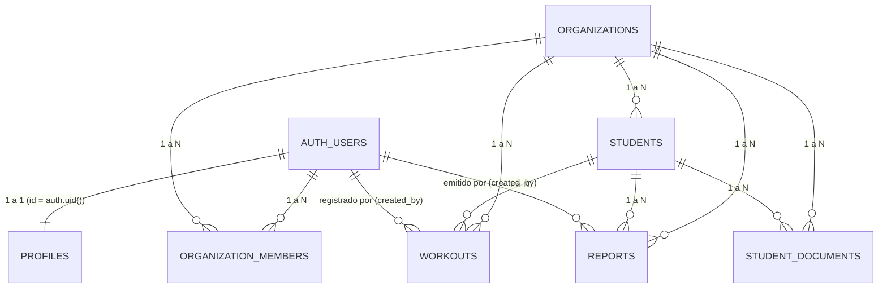

# BARDIA — Especificación y Esquema de Base de Datos PostgreSQL

> **Estado del Proyecto Supabase Remoto:**  
> Identificador del proyecto: `jlxqybmesrrrsnzdewdt` (Región `us-west-2`).  
> Estado verificado en vivo: `ACTIVE_HEALTHY` (PostgreSQL 17.6.1 en Supabase).  
> *Confirmación de auditoría remota:* El proyecto fue reactivado exitosamente por el usuario. Se inspeccionó el catálogo real del motor PostgreSQL (`information_schema.columns`, `storage.buckets`, `information_schema.routines`, `pg_policies`), confirmando una coincidencia del 100% entre el esquema físico de producción, los tipos TypeScript (`src/types/database.ts`) y este documento.

---

## 1. Visión general de la arquitectura de datos

BARDIA implementa un modelo **multi-tenant con aislamiento lógico por fila (Row Level Security)** en PostgreSQL gestionado a través de Supabase.

- **Unidad de aislamiento primario:** `organization_id` (clave foránea presente en todas las tablas de dominio: `students`, `workouts`, `student_documents`, `reports`).
- **Control de acceso:** Vinculación estricta entre `auth.users`, `public.profiles` y `public.organization_members`.
- **Roles de organización:**
  - `owner`: Administrador titular del estudio o equipo de entrenamiento.
  - `trainer`: Entrenador del equipo con permisos de lectura y registro operativo.



---

## 2. Definición detallada de tablas

### 2.1. `public.profiles`
Contiene la información de perfil público y datos personales del usuario registrado en el sistema.

| Columna | Tipo PostgreSQL | Nulable | Valor por defecto | Descripción |
|---|---|---|---|---|
| `id` | `uuid` | NO | - | Clave primaria. Referencia directa a `auth.users(id)` ON DELETE CASCADE. |
| `email` | `text` | NO | - | Correo electrónico de acceso del profesional. |
| `first_name` | `text` | NO | - | Nombre de pila del usuario. |
| `last_name` | `text` | NO | - | Apellido del usuario. |
| `avatar_url` | `text` | SÍ | `NULL` | URL de la imagen de perfil (Supabase Storage o externa). |
| `created_at` | `timestamptz` | NO | `now()` | Fecha y hora de creación del registro. |
| `updated_at` | `timestamptz` | NO | `now()` | Fecha y hora de última actualización. |

- **Restricciones e Índices:**
  - `PRIMARY KEY (id)`
  - `FOREIGN KEY (id) REFERENCES auth.users(id) ON DELETE CASCADE`
  - `CREATE INDEX idx_profiles_email ON public.profiles(email)`

---

### 2.2. `public.organizations`
Representa el estudio deportivo, club o equipo de corredores (el tenant).

| Columna | Tipo PostgreSQL | Nulable | Valor por defecto | Descripción |
|---|---|---|---|---|
| `id` | `bigint` | NO | `IDENTITY` | Identificador único de la organización. |
| `name` | `text` | NO | - | Nombre visible del estudio / equipo (ej. "Barda Trail Running"). |
| `slug` | `text` | NO | - | Identificador único alfanumérico amigable (ej. "barda-trail-1234"). |
| `logo_url` | `text` | SÍ | `NULL` | URL del isotipo o logo del equipo. |
| `created_at` | `timestamptz` | NO | `now()` | Fecha y hora de creación. |
| `updated_at` | `timestamptz` | NO | `now()` | Fecha y hora de última modificación. |

- **Restricciones e Índices:**
  - `PRIMARY KEY (id)`
  - `UNIQUE (slug)`
  - `CREATE INDEX idx_organizations_slug ON public.organizations(slug)`

---

### 2.3. `public.organization_members`
Tabla puente de membresía que asocia usuarios autenticados con organizaciones y define sus roles.

| Columna | Tipo PostgreSQL | Nulable | Valor por defecto | Descripción |
|---|---|---|---|---|
| `id` | `bigint` | NO | `IDENTITY` | Clave primaria. |
| `organization_id` | `bigint` | NO | - | FK a `organizations(id)` ON DELETE CASCADE. |
| `user_id` | `uuid` | NO | - | FK a `auth.users(id)` ON DELETE CASCADE. |
| `role` | `text` | NO | `'trainer'` | Rol asignado: `'owner'` o `'trainer'`. |
| `created_at` | `timestamptz` | NO | `now()` | Fecha de asignación de la membresía. |

- **Restricciones e Índices:**
  - `PRIMARY KEY (id)`
  - `FOREIGN KEY (organization_id) REFERENCES public.organizations(id) ON DELETE CASCADE`
  - `FOREIGN KEY (user_id) REFERENCES auth.users(id) ON DELETE CASCADE`
  - `CHECK (role IN ('owner', 'trainer'))`
  - `UNIQUE (organization_id, user_id)`
  - `CREATE INDEX idx_org_members_user ON public.organization_members(user_id)`
  - `CREATE INDEX idx_org_members_org ON public.organization_members(organization_id)`

---

### 2.4. `public.students`
Registro de deportistas asignados a una organización para su seguimiento continuo.

| Columna | Tipo PostgreSQL | Nulable | Valor por defecto | Descripción |
|---|---|---|---|---|
| `id` | `bigint` | NO | `IDENTITY` | Clave primaria del alumno. |
| `organization_id` | `bigint` | NO | - | FK a `organizations(id)` ON DELETE CASCADE. |
| `first_name` | `text` | NO | - | Nombre del deportista. |
| `last_name` | `text` | NO | - | Apellido del deportista. |
| `email` | `text` | SÍ | `NULL` | Correo del alumno. |
| `phone` | `text` | SÍ | `NULL` | Teléfono / WhatsApp de contacto. |
| `birth_date` | `date` | SÍ | `NULL` | Fecha de nacimiento. |
| `id_number` | `text` | SÍ | `NULL` | DNI o documento de identidad. |
| `discipline` | `text` | NO | - | Disciplina: Trail Running, Running Calle, Trekking, etc. |
| `level` | `text` | NO | - | Nivel: Inicial, Intermedio, Avanzado, Elite. |
| `sport_goals` | `text` | SÍ | `NULL` | Objetivos deportivos y de carrera. |
| `coach_notes` | `text` | SÍ | `NULL` | Observaciones técnicas y antecedentes del coach. |
| `emergency_contact_name` | `text` | SÍ | `NULL` | Nombre del contacto de urgencia. |
| `emergency_contact_phone` | `text` | SÍ | `NULL` | Teléfono del contacto de urgencia. |
| `emergency_contact_relation` | `text` | SÍ | `NULL` | Vínculo (Cónyuge, Padre, Hermano, etc.). |
| `medical_insurance` | `text` | SÍ | `NULL` | Prepaga u obra social (OSDE, ISSN, etc.). |
| `medical_insurance_number` | `text` | SÍ | `NULL` | Número de carnet / afiliado de salud. |
| `emergency_notes` | `text` | SÍ | `NULL` | Alergias, grupo sanguíneo, medicación habitual. |
| `is_active` | `boolean` | NO | `true` | Bandera de baja lógica y estado activo/inactivo. |
| `created_at` | `timestamptz` | NO | `now()` | Fecha de alta en la plataforma. |
| `updated_at` | `timestamptz` | NO | `now()` | Fecha de última edición. |

- **Restricciones e Índices:**
  - `PRIMARY KEY (id)`
  - `FOREIGN KEY (organization_id) REFERENCES public.organizations(id) ON DELETE CASCADE`
  - `CREATE INDEX idx_students_org ON public.students(organization_id)`
  - `CREATE INDEX idx_students_active ON public.students(organization_id, is_active)`
  - `CREATE INDEX idx_students_name ON public.students(organization_id, last_name, first_name)`

---

### 2.5. `public.student_documents`
Ficha de metadatos de documentos privados de deportistas (aptos físicos, ergometrías, certificados).

| Columna | Tipo PostgreSQL | Nulable | Valor por defecto | Descripción |
|---|---|---|---|---|
| `id` | `bigint` | NO | `IDENTITY` | Clave primaria. |
| `organization_id` | `bigint` | NO | - | FK a `organizations(id)` ON DELETE CASCADE. |
| `student_id` | `bigint` | NO | - | FK a `students(id)` ON DELETE CASCADE. |
| `title` | `text` | NO | - | Título visible del documento. |
| `file_path` | `text` | NO | - | Ruta en el bucket privado (`org_X/student_Y/...`). |
| `file_name` | `text` | NO | - | Nombre original del archivo. |
| `file_size` | `bigint` | SÍ | `NULL` | Tamaño en bytes. |
| `mime_type` | `text` | SÍ | `NULL` | Tipo MIME (`application/pdf`, etc.). |
| `created_at` | `timestamptz` | NO | `now()` | Fecha y hora de carga. |

- **Restricciones e Índices:**
  - `PRIMARY KEY (id)`
  - `FOREIGN KEY (organization_id) REFERENCES public.organizations(id) ON DELETE CASCADE`
  - `FOREIGN KEY (student_id) REFERENCES public.students(id) ON DELETE CASCADE`
  - `CREATE INDEX idx_student_docs_student ON public.student_documents(student_id)`
  - `CREATE INDEX idx_student_docs_org ON public.student_documents(organization_id)`

---

### 2.6. `public.workouts`
Sesiones de entrenamiento deportivo registradas con métricas de distancia, tiempo, desnivel y FC.

| Columna | Tipo PostgreSQL | Nulable | Valor por defecto | Descripción |
|---|---|---|---|---|
| `id` | `bigint` | NO | `IDENTITY` | Clave primaria de la sesión. |
| `organization_id` | `bigint` | NO | - | FK a `organizations(id)` ON DELETE CASCADE. |
| `student_id` | `bigint` | NO | - | FK a `students(id)` ON DELETE CASCADE. |
| `created_by` | `uuid` | SÍ | `NULL` | FK a `auth.users(id)` ON DELETE SET NULL. Coach que cargó la sesión. |
| `workout_date` | `date` | NO | - | Fecha en que se realizó el entrenamiento. |
| `title` | `text` | NO | - | Título de la sesión (ej. "Fondo Barda Norte 15k"). |
| `workout_type` | `text` | NO | - | Tipología: Fondo, Cuestas, Pasadas, Regenerativo, etc. |
| `notes` | `text` | SÍ | `NULL` | Observaciones técnicas y sensaciones. |
| `distance_km` | `numeric(6,2)` | SÍ | `NULL` | Distancia total en kilómetros. |
| `duration_seconds` | `integer` | SÍ | `NULL` | Tiempo total transcurrido en segundos. |
| `elevation_gain_m` | `integer` | SÍ | `NULL` | Desnivel positivo acumulado en metros (+m). |
| `average_pace_sec_km` | `integer` | SÍ | `NULL` | Ritmo medio en segundos por kilómetro. |
| `average_hr` | `integer` | SÍ | `NULL` | Frecuencia cardíaca media en ppm (bpm). |
| `max_hr` | `integer` | SÍ | `NULL` | Frecuencia cardíaca máxima en ppm (bpm). |
| `extra_metrics` | `jsonb` | SÍ | `'{}'::jsonb` | Métricas adicionales (cadencia, potencia, etc.). |
| `created_at` | `timestamptz` | NO | `now()` | Fecha y hora de creación del registro. |
| `updated_at` | `timestamptz` | NO | `now()` | Fecha y hora de actualización. |

- **Restricciones e Índices:**
  - `PRIMARY KEY (id)`
  - `FOREIGN KEY (organization_id) REFERENCES public.organizations(id) ON DELETE CASCADE`
  - `FOREIGN KEY (student_id) REFERENCES public.students(id) ON DELETE CASCADE`
  - `FOREIGN KEY (created_by) REFERENCES auth.users(id) ON DELETE SET NULL`
  - `CREATE INDEX idx_workouts_student_date ON public.workouts(student_id, workout_date DESC)`
  - `CREATE INDEX idx_workouts_org_date ON public.workouts(organization_id, workout_date DESC)`

---

### 2.7. `public.reports`
Informes profesionales y devoluciones técnicas emitidas para los alumnos.

| Columna | Tipo PostgreSQL | Nulable | Valor por defecto | Descripción |
|---|---|---|---|---|
| `id` | `bigint` | NO | `IDENTITY` | Clave primaria del informe. |
| `organization_id` | `bigint` | NO | - | FK a `organizations(id)` ON DELETE CASCADE. |
| `student_id` | `bigint` | NO | - | FK a `students(id)` ON DELETE CASCADE. |
| `created_by` | `uuid` | SÍ | `NULL` | FK a `auth.users(id)`. Entrenador que generó el informe. |
| `title` | `text` | NO | - | Título del reporte (ej. "Balance Mensual - Septiembre"). |
| `date_from` | `date` | NO | - | Fecha de inicio del período analizado. |
| `date_to` | `date` | NO | - | Fecha de fin del período analizado. |
| `coach_summary` | `text` | SÍ | `NULL` | Devolución técnica y conclusiones editoriales del coach. |
| `metrics_snapshot` | `jsonb` | NO | - | Snapshot inmutable de las métricas consolidadas del período. |
| `created_at` | `timestamptz` | NO | `now()` | Fecha y hora de generación. |

- **Estructura del `metrics_snapshot` JSONB:**
  ```json
  {
    "total_workouts": 12,
    "total_distance_km": 145.5,
    "total_duration_seconds": 43200,
    "total_elevation_m": 3450,
    "avg_pace_sec_km": 298,
    "avg_hr": 154,
    "workouts_list": [ ... ]
  }
  ```

---

## 3. Funciones PostgreSQL y Procedimientos Almacenados (RPC)

### 3.1. `create_organization_and_owner(p_name text, p_slug text)`
- **Propósito:** Creación atómica de una organización y auto-asignación del usuario actual como `owner`, resolviendo la condición de carrera inicial en el registro cuando el usuario aún no posee membresías activas.
- **Modo de Seguridad:** `SECURITY DEFINER` (se ejecuta con privilegios elevados controlados para insertar en `organizations` y `organization_members`).
- **Retorno:** `bigint` (el ID de la nueva organización).
- **Parámetros:**
  - `p_name text`: Nombre de la organización.
  - `p_slug text`: Identificador único generado.

```sql
CREATE OR REPLACE FUNCTION public.create_organization_and_owner(
  p_name text,
  p_slug text
)
RETURNS bigint
LANGUAGE plpgsql
SECURITY DEFINER
SET search_path = public
AS $$
DECLARE
  v_user_id uuid;
  v_org_id bigint;
BEGIN
  v_user_id := auth.uid();
  IF v_user_id IS NULL THEN
    RAISE EXCEPTION 'Usuario no autenticado.';
  END IF;

  -- 1. Insertar la organización
  INSERT INTO public.organizations (name, slug)
  VALUES (p_name, p_slug)
  RETURNING id INTO v_org_id;

  -- 2. Insertar membresía de owner
  INSERT INTO public.organization_members (organization_id, user_id, role)
  VALUES (v_org_id, v_user_id, 'owner');

  RETURN v_org_id;
END;
$$;
```

---

## 4. Supabase Storage: Bucket `documents`

- **Nombre del bucket:** `documents`
- **Público:** `FALSE` (Privado).
- **Convención de ruta obligatoria:**  
  `org_{organization_id}/student_{student_id}/{timestamp}_{filename}`
- **Descarga:** Exclusiva mediante URLs firmadas temporales (`createSignedUrl(path, 120)`).
- **Tipos MIME permitidos:** `application/pdf`, `image/png`, `image/jpeg`, `image/webp`.
