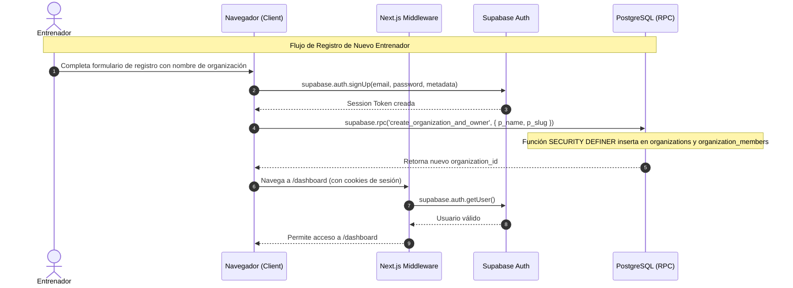
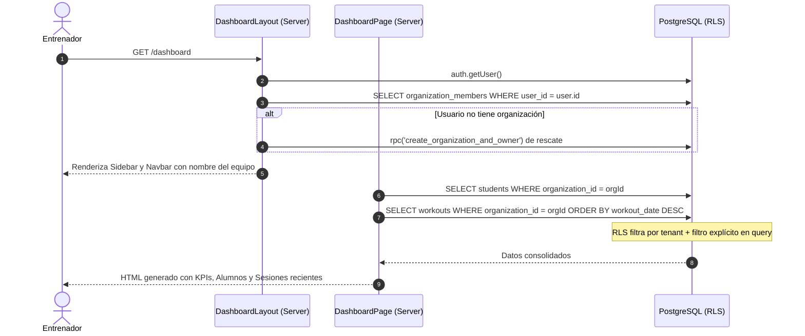
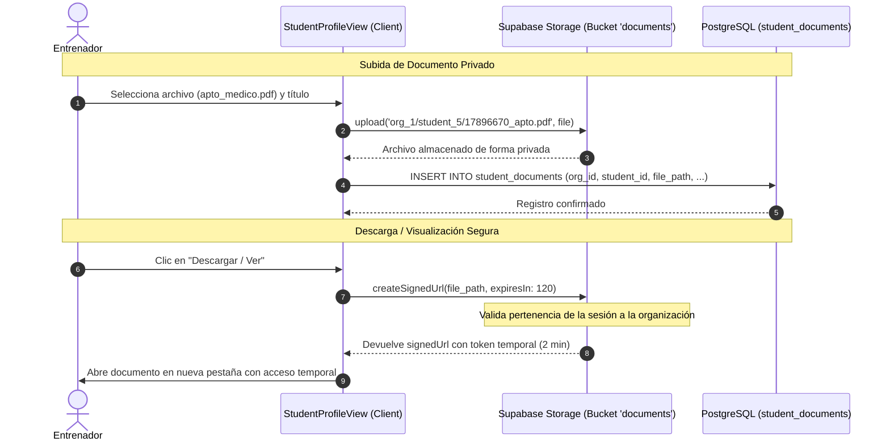
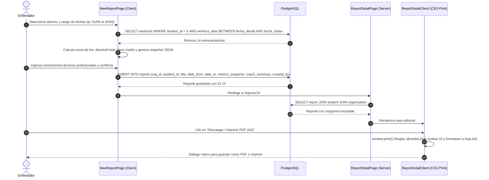

# BARDIA — Flujos de Peticiones y Ciclo de Vida de Datos

## 1. Flujo de Autenticación, Registro y Creación Atómica de Tenant



---

## 2. Flujo de Acceso al Dashboard y Resolución de Tenant Multi-Tenant



---

## 3. Flujo de Carga de Entrenamiento y Computación de Altimetría

```mermaid
sequenceDiagram
    autonumber
    actor Coach as Entrenador
    participant ClientForm as WorkoutForm (Client)
    participant Utils as utils.ts (calculatePace)
    participant SupaDB as PostgreSQL

    Coach->>ClientForm: Ingresa distancia (ej. 14.5 km) y duración (1h 15m 00s)
    ClientForm->>Utils: calculatePace(14.5, 4500)
    Utils-->>ClientForm: Retorna ritmo (310 seg/km -> 5:10 /km)
    ClientForm-->>Coach: Muestra en vivo el ritmo calculado con Badge de velocidad
    Coach->>ClientForm: Ingresa desnivel (+420m), FC y notas técnicas; envía formulario
    ClientForm->>SupaDB: INSERT INTO workouts (organization_id, student_id, distance_km, elevation_gain_m, average_pace_sec_km, created_by, ...)
    SupaDB-->>ClientForm: Sesión registrada con éxito
    ClientForm->>Coach: Redirige a /students/[id] con router.refresh()
```

---

## 4. Flujo Seguro de Documentación y URLs Firmadas de Storage



---

## 5. Flujo de Emisión e Impresión Editorial de Informes A4


