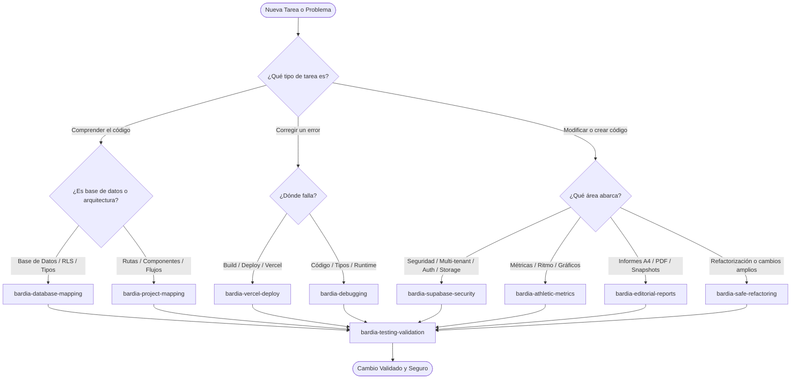

# Índice del Sistema de Skills de Desarrollo — BARDIA

Este documento es el catálogo maestro y la guía de activación del sistema de skills de desarrollo de **BARDIA**, ubicado en `.agents/skills/`.

Cada skill está estructurada con su archivo `SKILL.md` independiente, conteniendo disparadores de activación, procedimientos paso a paso, comandos reales del repositorio y referencias a la arquitectura técnica.

---

## 1. Mapa de Skills Disponibles

| Skill | Ubicación | Tipo | Propósito Principal |
| :--- | :--- | :--- | :--- |
| **`bardia-project-mapping`** | [`.agents/skills/bardia-project-mapping/SKILL.md`](file:///c:/Users/Franco/Desktop/BardIA/.agents/skills/bardia-project-mapping/SKILL.md) | Arquitectura | Explorar la estructura del proyecto, límites Server/Client y seguir el flujo de datos. |
| **`bardia-database-mapping`** | [`.agents/skills/bardia-database-mapping/SKILL.md`](file:///c:/Users/Franco/Desktop/BardIA/.agents/skills/bardia-database-mapping/SKILL.md) | Base de Datos | Inspeccionar tablas, relaciones, RPC, políticas RLS y tipos en `src/types/database.ts`. |
| **`bardia-debugging`** | [`.agents/skills/bardia-debugging/SKILL.md`](file:///c:/Users/Franco/Desktop/BardIA/.agents/skills/bardia-debugging/SKILL.md) | Diagnóstico | Encontrar causas raíz de errores sin recurrir a modificaciones permisivas ni `@ts-ignore`. |
| **`bardia-vercel-deploy`** | [`.agents/skills/bardia-vercel-deploy/SKILL.md`](file:///c:/Users/Franco/Desktop/BardIA/.agents/skills/bardia-vercel-deploy/SKILL.md) | Despliegue | Diagnosticar y prevenir fallos de build, variables de entorno y ejecución en Vercel. |
| **`bardia-supabase-security`** | [`.agents/skills/bardia-supabase-security/SKILL.md`](file:///c:/Users/Franco/Desktop/BardIA/.agents/skills/bardia-supabase-security/SKILL.md) | Seguridad | Garantizar aislamiento multi-tenant estricto, protección de cookies SSR y buckets privados. |
| **`bardia-safe-refactoring`** | [`.agents/skills/bardia-safe-refactoring/SKILL.md`](file:///c:/Users/Franco/Desktop/BardIA/.agents/skills/bardia-safe-refactoring/SKILL.md) | Mantenimiento | Realizar cambios incrementales conservando contratos de tipos y comportamiento funcional. |
| **`bardia-testing-validation`** | [`.agents/skills/bardia-testing-validation/SKILL.md`](file:///c:/Users/Franco/Desktop/BardIA/.agents/skills/bardia-testing-validation/SKILL.md) | Calidad | Validar cambios con comandos reproducibles (`tsc`, `lint`, `build`) y registrar evidencia. |
| **`bardia-athletic-metrics`** | [`.agents/skills/bardia-athletic-metrics/SKILL.md`](file:///c:/Users/Franco/Desktop/BardIA/.agents/skills/bardia-athletic-metrics/SKILL.md) | Dominio Deportivo | Fórmulas de ritmo, desnivel, zonas de FC y gráficos Recharts sin fallos matemáticos. |
| **`bardia-editorial-reports`** | [`.agents/skills/bardia-editorial-reports/SKILL.md`](file:///c:/Users/Franco/Desktop/BardIA/.agents/skills/bardia-editorial-reports/SKILL.md) | Dominio Editorial | Informes A4 inmutables con snapshots JSONB y reglas de impresión `@media print`. |

---

## 2. Matriz de Decisión: ¿Cuándo activar cada skill?



---

## 3. Conexión con la Documentación de Arquitectura

Las skills no duplican el conocimiento del repositorio; en su lugar, apuntan a las fuentes de verdad documentadas en `docs/architecture/`:

- **Esquema de Base de Datos y Diccionario de Datos:**
  [`docs/architecture/database-schema.md`](file:///c:/Users/Franco/Desktop/BardIA/docs/architecture/database-schema.md)
- **Relaciones entre Tablas y Diagrama ER:**
  [`docs/architecture/database-relations.md`](file:///c:/Users/Franco/Desktop/BardIA/docs/architecture/database-relations.md)
- **Seguridad RLS y Pruebas Negativas de Multi-Tenancy:**
  [`docs/architecture/security-rls.md`](file:///c:/Users/Franco/Desktop/BardIA/docs/architecture/security-rls.md)
- **Mapa de Componentes y Rutas App Router:**
  [`docs/architecture/project-map.md`](file:///c:/Users/Franco/Desktop/BardIA/docs/architecture/project-map.md)
- **Grafo de Dependencias entre Módulos:**
  [`docs/architecture/module-dependencies.md`](file:///c:/Users/Franco/Desktop/BardIA/docs/architecture/module-dependencies.md)
- **Flujos de Petición y Diagramas de Secuencia:**
  [`docs/architecture/request-flows.md`](file:///c:/Users/Franco/Desktop/BardIA/docs/architecture/request-flows.md)

---

## 4. Guía Rápida de Comandos del Repositorio

Para ejecutar las verificaciones que las skills requieren:

```bash
# Comprobación de tipos estáticos
npx tsc --noEmit

# Comprobación de ESLint
npm run lint

# Compilación completa de producción (Next.js)
npm run build

# Entorno de desarrollo local
npm run dev
```
